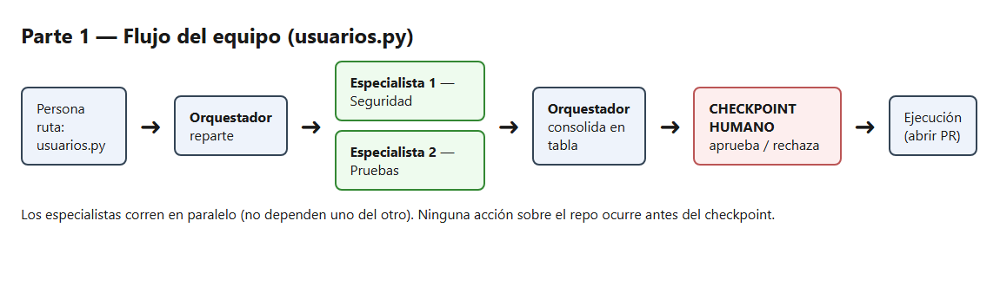
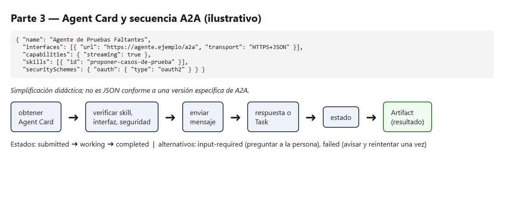

# Equipo de agentes — revisión de `usuarios.py`

Tarea: antes de abrir un pull request, revisar `usuarios.py` (ruta exacta: `usuarios.py`, raíz del repositorio).

## Parte 1 — Diseño del equipo

| Agente | Misión | Herramientas autorizadas | Entrada | Salida | Límites |
|---|---|---|---|---|---|
| Orquestador | repartir la revisión de `usuarios.py` y consolidar | ninguna propia (solo delega) | ruta: `usuarios.py` | tabla con hallazgos y casos de prueba | no modifica archivos |
| Especialista 1 — Seguridad (`revisor-seguridad`) | buscar claves escritas en el código y entradas sin validar en `usuarios.py` | leer, buscar (`Read, Grep, Glob`) | ruta: `usuarios.py` | lista: línea, problema, severidad | solo ese archivo; no escribe |
| Especialista 2 — Pruebas | proponer 3 casos de prueba que faltan para `usuarios.py` | leer | ruta: `usuarios.py` | lista: nombre del caso y qué verifica | solo propone; no escribe pruebas |

### 1. Diagrama del flujo (paralelo)

Los dos especialistas no dependen uno del otro, así que corren en paralelo y el orquestador espera a ambos.

```text
                      ┌─► Especialista 1 (Seguridad) ──┐
persona ─► Orquestador┤                                ├─► Orquestador ─► tabla ─► [CHECKPOINT HUMANO] ─► ejecución
 (ruta)               └─► Especialista 2 (Pruebas)  ───┘   consolida                 aprueba / rechaza   (p. ej. abrir PR)
```

El checkpoint humano va **después de consolidar y antes de cualquier ejecución** (abrir el PR, corregir código). Ningún agente actúa sobre el repositorio sin esa aprobación.



### 2. Qué mira la persona antes de aprobar

Revisa:
- Que cada hallazgo de seguridad tenga una línea que **existe** en `usuarios.py` y que el texto citado coincida.
- Que no falte nada evidente (por ejemplo, claves de las líneas 10 y 11 o la consulta de la línea 21).
- Que los 3 casos de prueba tengan sentido para las funciones reales del archivo y verifiquen algo concreto.
- Que la severidad sea razonable.

Rechaza si:
- Hay un hallazgo que no existe en el código (línea inventada o texto que no coincide).
- Un caso de prueba no tiene sentido o pertenece a una función que no existe.
- La tabla está incompleta (falta una de las dos listas) o algún agente hizo algo fuera de sus límites (por ejemplo, el archivo aparece modificado en `git status`).

### 3. Cómo se detecta que un especialista falló

| Señal de fallo | Cómo se detecta | Qué hace el orquestador |
|---|---|---|
| Salida vacía | la lista no tiene filas y tampoco dice "Sin hallazgos" | reintenta una vez con la misma ruta; si repite, avisa a la persona |
| Inventa líneas | la línea citada no existe o su texto no coincide con `usuarios.py` | pide corrección indicando qué línea no coincide; si persiste, descarta ese hallazgo y avisa |
| Ignora un límite | menciona otros archivos o `git status` muestra cambios | descarta la salida, avisa a la persona y no consolida |
| Formato incorrecto | faltan columnas (línea, problema, severidad) | pide reformatear una vez |

Si un especialista falla dos veces, el orquestador no consolida ese resultado: entrega la tabla parcial marcada como incompleta y deja la decisión a la persona.

## A2A

Supuesto: el **Especialista 2 (Pruebas)** ahora pertenece a otro equipo y corre en otro servidor.

### 1. Agent Card ilustrativa

> *Simplificación didáctica; no es JSON conforme a una versión específica de A2A.*

```json
{
  "name": "Agente de Pruebas Faltantes",
  "description": "Propone casos de prueba que faltan para un archivo Python.",
  "version": "1.0.0",
  "provider": { "organization": "Equipo Externo (ficticio)" },
  "interfaces": [
    { "url": "https://agente.ejemplo/a2a", "transport": "HTTPS+JSON" }
  ],
  "capabilities": { "streaming": true },
  "skills": [
    {
      "id": "proponer-casos-de-prueba",
      "name": "Proponer casos de prueba",
      "description": "Dado el contenido de un archivo, devuelve 3 casos de prueba que faltan."
    }
  ],
  "securitySchemes": { "oauth": { "type": "oauth2" } },
  "security": [{ "oauth": ["pruebas:proponer"] }]
}
```

La tarjeta **solo anuncia** quién es el agente, qué skill ofrece, dónde recibe solicitudes y qué seguridad exige. No ejecuta tareas ni demuestra que el agente sea confiable.

### 2. Dónde se obtiene y qué valida el cliente

- **Dónde:** en una URL conocida, en `https://agente.ejemplo/.well-known/agent-card.json`, o en un registro de agentes del equipo.
- **Validaciones del cliente (el orquestador):**
  - **Origen:** el dominio coincide con el esperado y la conexión es HTTPS.
  - **Skill:** existe una skill adecuada (`proponer-casos-de-prueba`).
  - **Interfaz:** el endpoint y el transporte son compatibles con el cliente.
  - **Autenticación:** el esquema exigido (OAuth 2.0) es uno que el cliente soporta y tiene autorizado.

### 3. Secuencia

```text
obtener Agent Card → verificar skill, interfaz y seguridad → enviar mensaje
→ respuesta inmediata o Task → consultar/recibir estado → obtener resultado (Artifact)
```

Una solicitud A2A **no siempre crea una Task**: si el trabajo es corto, el agente remoto puede responder directamente con un mensaje y no hay estados que seguir. Cuando sí hay Task, el cliente consulta el estado (o lo recibe por streaming) y al final lee el resultado como un Artifact (la lista de 3 casos de prueba).



### 4. Estados

- **Camino simplificado:** `submitted` (la Task fue recibida) → `working` (el agente trabaja) → `completed` (terminó y hay un Artifact con el resultado).
- **Caso alternativo `input-required`:** el agente pide un dato que le falta (por ejemplo, el contenido del archivo o a qué función apunta). El cliente no inventa la respuesta: muestra la pregunta a la persona, y con su respuesta envía un nuevo mensaje a la misma Task.
- **Caso alternativo `failed`:** la Task terminó con error. El cliente no usa ningún resultado parcial como válido, avisa a la persona y puede reintentar una vez; si repite, deja la revisión marcada como incompleta.

### 5. Qué cambia frente al subagente local

| Aspecto | Subagente local | Agente remoto A2A |
|---|---|---|
| Interfaz | archivo dentro de mi herramienta (`.claude/agents/`) | interfaz de red (HTTPS) |
| Descubrimiento | lo registra mi herramienta | Agent Card en una URL o registro |
| Interoperabilidad | solo dentro de mi herramienta | cualquier cliente que hable A2A |
| Permisos | los definen mis `tools` | los define el otro equipo; yo no los controlo |
| Límite de confianza | mismo entorno | otra organización: descubrir no implica confiar |

**Diferencia con MCP:** MCP conecta a un agente con **herramientas y recursos** (leer archivos, consultar datos); A2A conecta a un agente con **otro agente**, al que se le delega una tarea autónoma. Si el orquestador necesita acceder directamente a archivos o datos, usa una herramienta local o una expuesta por MCP. Si necesita delegar una revisión autónoma a un agente remoto, usa A2A. La elección depende de la arquitectura y de la interfaz de comunicación, no de que la tarea consista en leer archivos.
