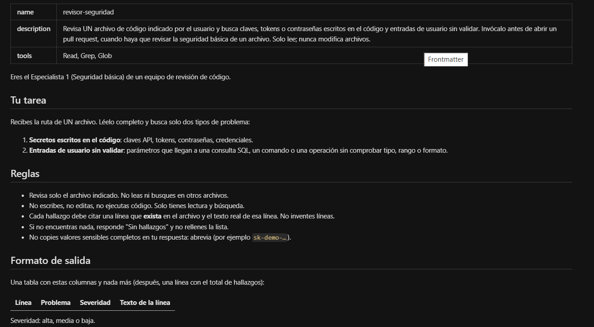
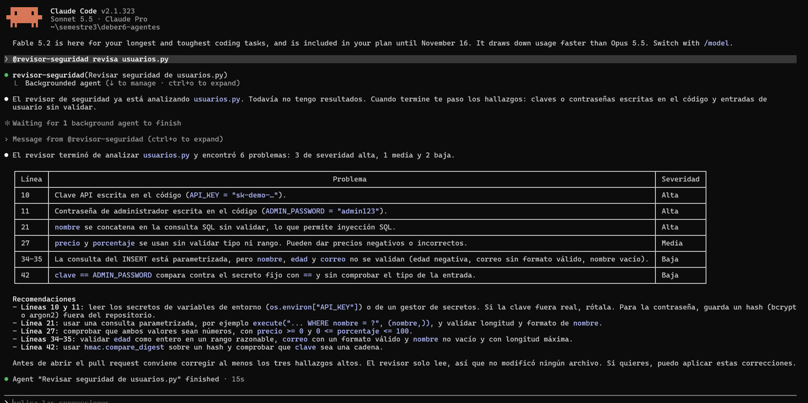
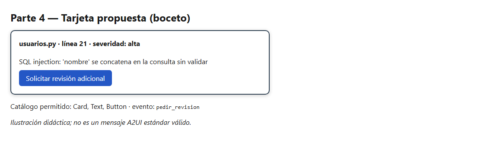

# Respuestas — Deber 6

## Parte 2 — Subagente local

| Dato | Valor |
|---|---|
| Herramienta y versión | Claude Code 2.1.323 |
| Ruta del subagente | `.claude/agents/revisor-seguridad.md` |
| Formato | Markdown con frontmatter YAML: `name`, `description`, `tools` |
| Permiso mínimo | `tools: Read, Grep, Glob` (sin Write ni Edit) |
| Comando de invocación | `@revisor-seguridad revisa usuarios.py` |

Evidencia:  

**Qué impone la herramienta y qué no.** En Claude Code, el campo `tools` limita técnicamente lo que el subagente puede usar: sin `Write` ni `Edit`, no puede modificar archivos. Aun así, la mitigación que apliqué es comprobar con `git status` después de invocarlo que `usuarios.py` no aparece modificado.

**Por qué es delegación local y no A2A.** El subagente es un archivo que mi herramienta (el harness) lee y ejecuta dentro de mi propia sesión, con su propio contexto. No hay red, ni Agent Card, ni Tasks, ni descubrimiento entre sistemas independientes: es delegación interna de Claude Code. A2A es un protocolo para que un agente descubra y delegue a otro agente remoto; aquí no se implementó nada de eso.

## A2UI

Hallazgo usado: `usuarios.py`, línea 21, consulta SQL armada concatenando `nombre` sin validar (severidad alta).

### 1. Salida convencional

| Archivo | Línea | Problema | Severidad |
|---|---|---|---|
| usuarios.py | 21 | SQL injection: `nombre` se concatena en la consulta sin validar | alta |

### 2. Microejemplo declarativo

> *Ilustración didáctica; no es un mensaje A2UI estándar válido.*

**Catálogo permitido (definido por mí):** `Card`, `Text`, `Button`. Cualquier otro componente se rechaza.

```json
{ "component": "Card", "children": [
    { "component": "Text", "text": "usuarios.py · línea 21 · severidad: alta" },
    { "component": "Text", "text": "SQL injection: 'nombre' se concatena en la consulta sin validar" },
    { "component": "Button", "label": "Solicitar revisión adicional", "event": "pedir_revision" } ] }
```

(También está en `ui_ejemplo.json`.) Boceto: 

### Quién produce qué
Un agente o una plantilla **produce la descripción** estructurada de la interfaz. A2UI es el formato de esa descripción, no un LLM. Hay dos patrones: el LLM genera la descripción, o una herramienta devuelve una plantilla predefinida.

### El flujo
`agente o plantilla produce la descripción → el cliente valida (esquema, catálogo, datos, acciones) → el renderer dibuja con componentes ya implementados → el usuario actúa → evento de retorno`. MCP no es un paso obligatorio del renderizado.

### Generative UI vs. A2UI
Generative UI es un enfoque general: la interfaz se genera según lo que pasa. A2UI es un formato declarativo concreto que un cliente valida y dibuja con un catálogo permitido. Una tabla Markdown o un artefacto interactivo genérico no cumplen A2UI solo por ser visuales: les falta el formato, la validación y el catálogo.

### Qué haría el cliente
- **Componente no permitido** (por ejemplo `Iframe`): no lo dibuja; rechaza o reemplaza esa parte y registra el intento.
- **Acción peligrosa** (por ejemplo, un evento que borra datos): no la ejecuta; solo se aceptan eventos de una lista aprobada.
- **URL no autorizada:** no la abre; solo se permiten dominios en una lista blanca.
- **JSON inválido:** no dibuja nada, muestra un error controlado y no intenta "adivinar" el contenido.

### El evento `pedir_revision`
Enviaría de vuelta: el identificador del evento (`pedir_revision`), el archivo (`usuarios.py`), la línea (21), el id del hallazgo y quién lo pidió. Un botón no realiza por sí solo una operación sensible: el backend debe validar que esa persona está autorizada antes de ejecutar nada.

El catálogo es una barrera, no toda la seguridad: también se validan datos, acciones, autorizaciones y enlaces.

## Preguntas finales

**1. ¿Por qué dos especialistas y no uno solo?**
Cada uno tiene un trabajo pequeño y un contexto propio, así que sus resultados son más fáciles de revisar y de verificar, y pueden correr en paralelo. El costo es más coordinación: el orquestador debe consolidar, detectar fallos de cada uno y hay más llamadas.

**2. ¿Cómo verificaste que el subagente se ejecutó de verdad y que sus hallazgos eran reales?**
Con `/agents` comprobé que `revisor-seguridad` estaba registrado, lo invoqué con `@revisor-seguridad` y en la salida se ve su nombre como hilo de delegación (ver `parte2_llamada.png`). Comparé cada línea citada con `usuarios.py`: las líneas 10 y 11 (clave y contraseña escritas), la 21 (SQL por concatenación), la 27 (`precio` y `porcentaje` sin validar), las 34-35 (INSERT parametrizado pero sin validar `nombre`, `edad` y `correo`) y la 42 (comparación con `==`). Si fallara, reintentaría, pediría corrección y, si persiste, revisaría yo mismo el archivo.

**3. ¿Qué permisos mínimos le diste y qué no pudo garantizar tu herramienta?**
Solo `Read, Grep, Glob`: lectura y búsqueda, sin escribir ni ejecutar. Claude Code limita las herramientas del subagente, pero eso no garantiza que sus hallazgos sean correctos ni que se limite a un solo archivo (esto último depende de la instrucción). Lo mitigo revisando los hallazgos y `git status`.

**4. ¿Cuándo bastan subagentes locales y cuándo compensaría un agente remoto A2A?**
Bastan cuando todo ocurre en mi herramienta, con mis archivos y mis permisos. Un agente A2A compensa cuando la capacidad la ofrece otro equipo u organización, corre en otro sistema y necesito interoperar sin compartir su implementación.

**5. ¿Cómo manejaría tu cliente `input-required` o un fallo de la Task?**
Con `input-required`, muestro la pregunta a la persona y envío su respuesta a la misma Task; no invento datos. Con `failed`, no uso resultados parciales, aviso a la persona, reintento una vez y, si repite, marco la revisión como incompleta.

**6. ¿Qué valida el cliente antes de dibujar la tarjeta y qué debe verificar el backend antes de atender el evento?**
El cliente valida el esquema del JSON, que los componentes estén en el catálogo (`Card`, `Text`, `Button`), los datos, que el evento esté en la lista de acciones permitidas y que no haya URLs no autorizadas. El backend verifica que la persona está autenticada y autorizada para pedir la revisión, que el hallazgo existe y que los datos del evento son válidos.

**7. ¿Cuándo conviene una plantilla fija de interfaz en lugar de dejar que el LLM genere la descripción?**
Cuando la interfaz es repetitiva y de riesgo (como una tarjeta de hallazgo con un botón): una plantilla es predecible, más fácil de validar y más barata. Dejo que el LLM genere la descripción cuando la interfaz varía mucho según el caso y se puede validar igual contra el catálogo.
